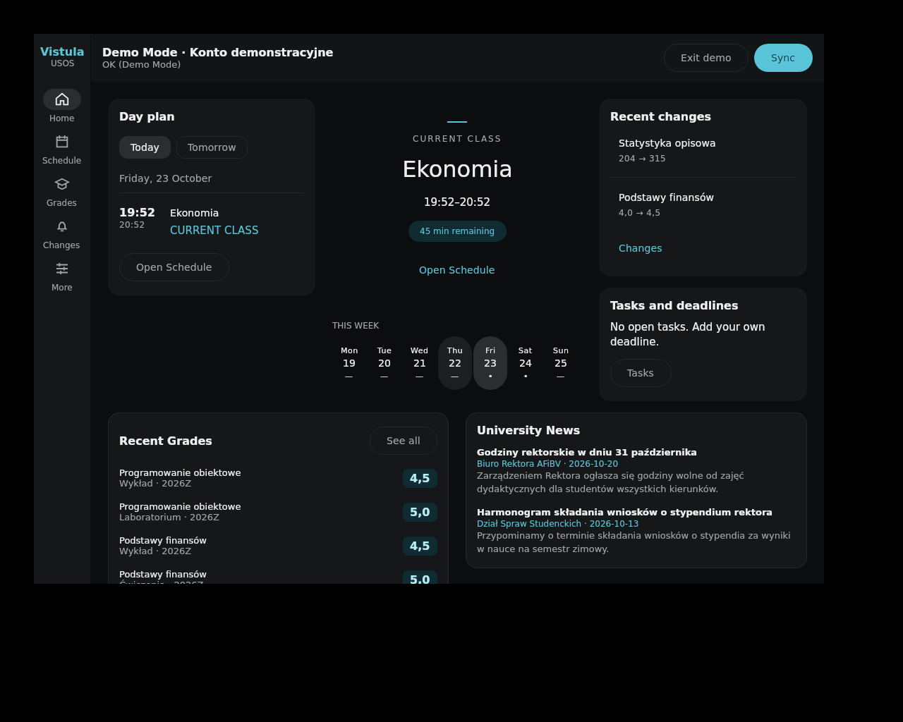
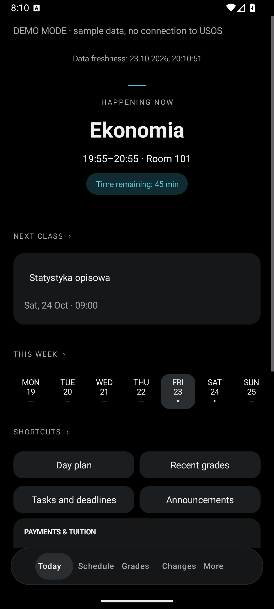
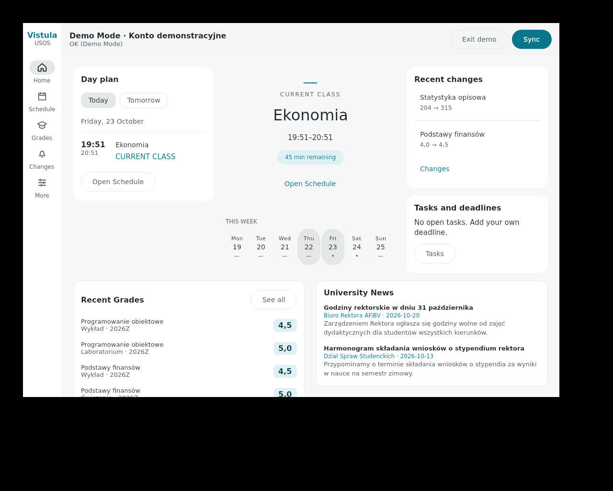
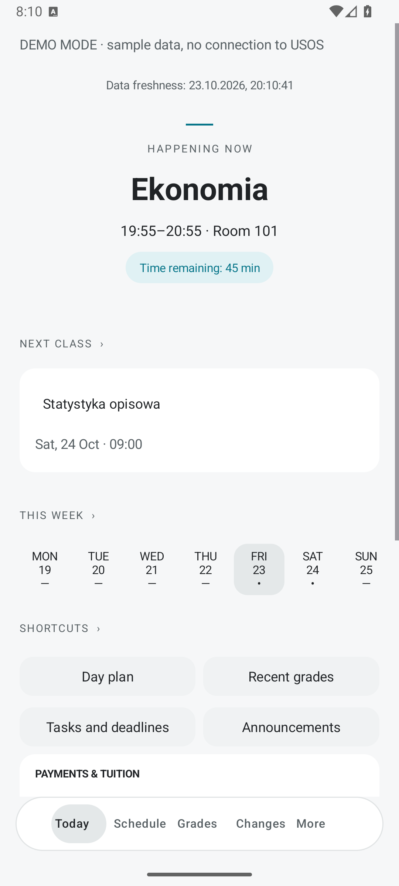
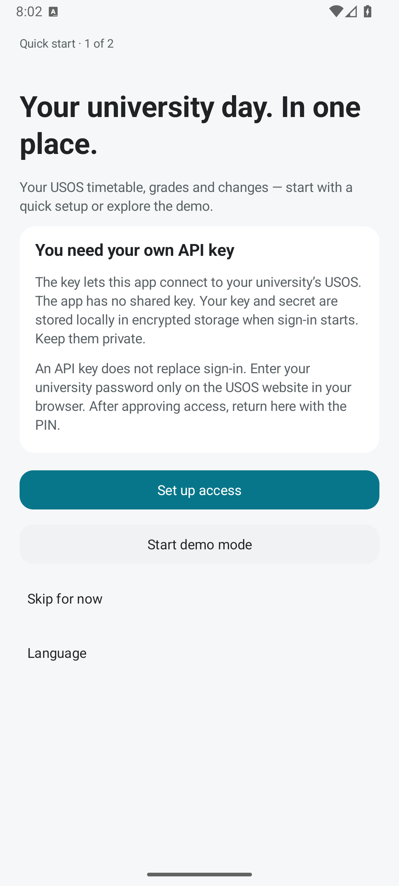
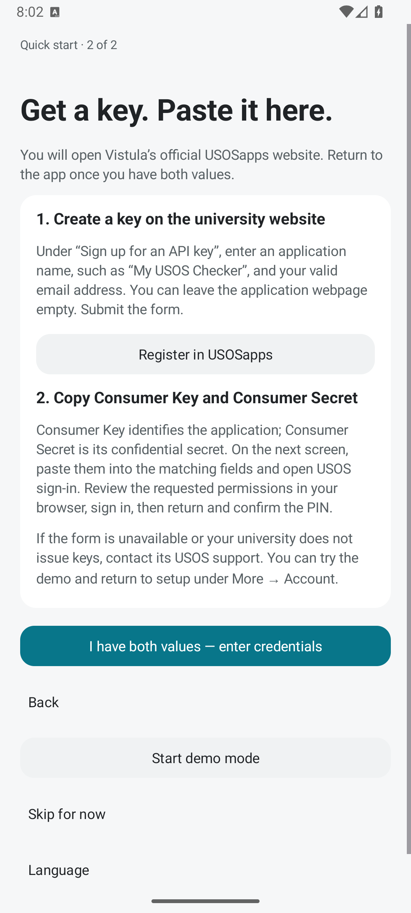

<div align="center">

# USOS Checker

### Twój dzień na uczelni. W jednym miejscu.
### Your university day. In one place.

Plan zajęć, oceny i zmiany dla studentów Vistuli — Android i desktop.<br>
Timetable, grades and changes for Vistula students — Android and desktop.

**[Polski](#polski)** · **[English](#english)** · **[Pobierz / Download](https://github.com/a0w-svg/usoschecker-public/releases/latest)** · **[Prototyp / Design](https://usoscheckerdesign.vercel.app/)**

Android 12+ · Windows x64 · Linux · Kotlin · MIT

Nieoficjalna aplikacja. / Unofficial application.

</div>

---

<h2 align="center">Dzisiaj — ciemny / Today — dark</h2>

<table>
  <tr><th>Desktop</th><th>Android</th></tr>
  <tr>
    <td width="74%" align="center"></td>
    <td width="26%" align="center"></td>
  </tr>
</table>

<h2 align="center">Dzisiaj — jasny / Today — light</h2>

<table>
  <tr><th>Desktop</th><th>Android</th></tr>
  <tr>
    <td width="74%" align="center"></td>
    <td width="26%" align="center"></td>
  </tr>
</table>

<p align="center">Zrzuty działającej aplikacji z danymi demonstracyjnymi. / Screenshots of the running app using demo data.</p>

---

## Polski

USOS Checker zbiera najważniejsze informacje z USOS Akademii Finansów i Biznesu Vistula. Otwierasz aplikację i widzisz bieżące lub najbliższe zajęcia, pozostały plan dnia oraz ostatnie zmiany. Motywy jasny i ciemny, neutralne karty i turkusowy akcent nawiązują do [projektu interfejsu](https://usoscheckerdesign.vercel.app/).

### Co znajdziesz w aplikacji

| Ekran | Możliwości |
| --- | --- |
| **Dzisiaj** | Bieżące lub najbliższe zajęcia, odliczanie, dalszy plan dnia, ostatnie zmiany, podgląd tygodnia i skróty. |
| **Plan** | Widoki dnia, tygodnia i agendy; wyszukiwanie, szczegóły zajęć, prowadzący, sale, kolizje, przerwy i eksport `.ics`. |
| **Oceny** | Semestry, wyszukiwanie, filtry, terminy zaliczeń, przedmioty bez ocen oraz pomocnicze podsumowania średniej. |
| **Zmiany** | Historia dodanych, zmienionych i usuniętych wpisów z wartościami przed i po zmianie. |
| **Więcej** | Zadania, osobista frekwencja, płatności, legitymacje, dokumenty i decyzje, wiadomości uczelni, kampus, kalkulator GPA, konto i katalog API. |

Interfejs obsługuje **polski, angielski i ukraiński**. Android dopasowuje motyw do telefonu lub pozwala wybrać jasny albo ciemny OLED. Tryb demo działa oddzielnie od prawdziwego konta.

### Pobieranie

Otwórz **[najnowsze wydanie](https://github.com/a0w-svg/usoschecker-public/releases/latest)**. Dla Androida pobierz `VistulaChecker-X.Y.Z.apk`; dla Windows wybierz instalator MSI lub przenośny ZIP, a dla Linuksa pakiet DEB, jeżeli są dołączone do wydania. Źródła i sumy SHA-256 znajdują się przy plikach wydania.

Android wymaga **wersji 12 lub nowszej**. Aktualizacje APK zachowują podpis poprzednich wydań. Instalację i uprawnienia zatwierdzasz w systemie.

### Pierwsze uruchomienie — własny klucz API

1. W ekranie powitalnym wybierz **Skonfiguruj dostęp**. Możesz też uruchomić demo lub pominąć konfigurację.
2. Otwórz [oficjalny formularz USOSapps Vistuli](https://usosapps.vistula.edu.pl/developers/). W sekcji **Sign up for an API key** podaj nazwę aplikacji i prawidłowy adres e-mail. Stronę aplikacji możesz zostawić pustą.
3. Skopiuj **Consumer Key** i **Consumer Secret** do odpowiadających im pól w aplikacji. Nie udostępniaj sekretu.
4. Wybierz zakresy dostępu i otwórz logowanie USOS. Hasło uczelniane wpisujesz na stronie uczelni w przeglądarce.
5. Po zatwierdzeniu zgód wróć do aplikacji, wklej **PIN** i potwierdź połączenie.

Przewodnik można ponownie otworzyć w **Więcej → Konto → Połączenie z USOS**. Jeżeli formularz nie jest dostępny lub nie możesz uzyskać klucza, skontaktuj się z pomocą USOS uczelni; demo pozostaje dostępne.

<details>
<summary>Podgląd przewodnika pierwszego uruchomienia</summary>

<p align="center"> </p>

</details>

### Prywatność i dane

Hasło uczelniane nie trafia do aplikacji. Android przechowuje klucze, tokeny i dane konta lokalnie w szyfrowanym magazynie opartym na Android Keystore. Release nie zawiera wspólnego Consumer Secret. Aplikacja łączy się bezpośrednio z USOS, pobiera publiczne wiadomości uczelni i sprawdza wydania na GitHubie. Szczegóły: **[SECURITY.md](SECURITY.md)**.

Wskazania planu opierają się na ostatnio pobranych danych. Terminy orientacyjne są oznaczane. Średnie i osobista frekwencja są narzędziami pomocniczymi, nie oficjalną dokumentacją uczelni. Dostępność usług zależy od konta i udzielonych zgód.

### Budowanie i testy

Wymagane: **JDK 21**, **Android SDK 36** i dołączony wrapper Gradle. Otwórz katalog z `settings.gradle` w Android Studio. Instrukcja: [ANDROID_STUDIO.md](ANDROID_STUDIO.md).

```powershell
.\gradlew.bat :app:assembleDebug -PisolatedTests
.\tools\production-check.ps1 -DeviceTests
```

`-PisolatedTests` tworzy osobną aplikację QA (`pl.vistula.checker.qa`). Testy urządzenia wymagają emulatora lub urządzenia ADB. Przygotowanie podpisanego wydania: **[RELEASE.md](RELEASE.md)**. Kontrole i ich ograniczenia: [VALIDATION.md](VALIDATION.md). Konfiguracja lokalna: [local.properties.example](local.properties.example).

---

## English

USOS Checker brings together key information from Vistula University’s USOS. Open the app to see your current or next class, the rest of the day and recent changes. Light and dark themes, neutral cards and a cyan accent follow the [interface prototype](https://usoscheckerdesign.vercel.app/).

### What is inside

| Screen | Features |
| --- | --- |
| **Today** | Current or next class, countdown, remaining classes, recent changes, week preview and shortcuts. |
| **Schedule** | Day, week and agenda views; search, class details, lecturers, rooms, conflicts, breaks and `.ics` export. |
| **Grades** | Semesters, search, filters, assessment attempts, ungraded courses and supporting average calculations. |
| **Changes** | Added, updated and removed records, with before/after values. |
| **More** | Tasks, personal attendance, payments, student cards, documents and decisions, university news, campus information, GPA calculator, account settings and API catalog. |

The interface supports **Polish, English and Ukrainian**. Android follows the phone’s theme or uses a manual light/OLED dark setting. Demo mode is separate from your real account.

### Download

Open the **[latest release](https://github.com/a0w-svg/usoschecker-public/releases/latest)**. For Android, download `VistulaChecker-X.Y.Z.apk`; for Windows, choose the MSI installer or portable ZIP, and for Linux, the DEB package when included in that release. Source archives and SHA-256 checksums accompany the release files.

Android requires **version 12 or later**. APK updates keep the signing identity of previous releases. You approve installation and permissions through the operating system.

### First launch — bring your own API key

1. Choose **Set up access** on the welcome screen. You can also explore the demo or skip setup.
2. Open [Vistula’s official USOSapps form](https://usosapps.vistula.edu.pl/developers/). Under **Sign up for an API key**, enter an application name and a valid email address. The application webpage is optional.
3. Copy **Consumer Key** and **Consumer Secret** into the matching fields in the app. Keep the secret private.
4. Select access scopes and open USOS sign-in. Enter your university password on the university website in your browser.
5. After approving access, return to the app, paste the **PIN** and confirm the connection.

Reopen the guide under **More → Account → USOS connection**. If the form is unavailable or you cannot obtain a key, contact your university’s USOS support; demo mode remains available.

### Privacy and data

Your university password never enters the app. Android keeps keys, tokens and account data locally in encrypted storage backed by Android Keystore. Release builds contain no shared Consumer Secret. The app connects directly to USOS, fetches public university news and checks GitHub for releases. See **[SECURITY.md](SECURITY.md)** for details.

Timetable indicators use the last downloaded data. Tentative times are labelled. Averages and personal attendance are supporting tools, not official university records. Available services depend on your account and granted scopes.

### Build and verify

Requirements: **JDK 21**, **Android SDK 36** and the included Gradle wrapper. Open the folder containing `settings.gradle` in Android Studio; see [ANDROID_STUDIO.md](ANDROID_STUDIO.md).

```sh
./gradlew :app:assembleDebug -PisolatedTests
./gradlew :core:test :shared:desktopTest :desktopApp:compileKotlin :app:testDebugUnitTest :app:lintRelease :app:assembleRelease -PisolatedTests
```

On Windows, `tools/production-check.ps1 -DeviceTests` runs the release gate with device tests. `-PisolatedTests` uses a separate QA application (`pl.vistula.checker.qa`). Device tests require an emulator or ADB device. Release signing and packaging: **[RELEASE.md](RELEASE.md)**. Verification scope: [VALIDATION.md](VALIDATION.md). Local configuration example: [local.properties.example](local.properties.example).

---

<h2 align="center">Autorzy / Contributors</h2>

<p align="center">
  <a href="https://github.com/a0w-svg"><strong>a0w-svg</strong></a> — autor aplikacji / application author<br>
  <a href="https://github.com/Kaydjen"><strong>Kaydjen</strong></a> — współautor designu / design co-author<br>
  <a href="https://usoscheckerdesign.vercel.app/">Interaktywny prototyp / Interactive prototype</a>
</p>

<p align="center">Licencja / License: <a href="LICENSE">MIT</a>. Biblioteki zewnętrzne zachowują własne licencje. / Third-party libraries retain their own licenses.</p>
